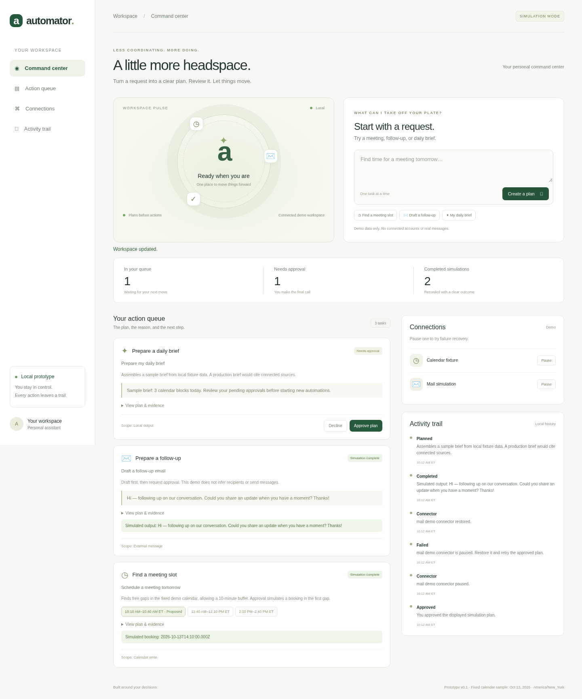

# Automator

A visual starter for a personal automation assistant: turn a request into a plan, review its evidence, approve it, and track the result.



## Run in the cloud environment

Requires Node.js 22 or newer. There are no external runtime dependencies and no API keys are needed for the prototype.

```sh
cd /workspace/Automator
npm test
npm start
```

The local server listens on port 3000. Validate it internally with `curl --fail http://127.0.0.1:3000/api/health`. This onboarding environment does not provide a public app preview. The screenshot above shows the interface; local browser checks exercise the application.

On your own development machine, open the local server in a browser. Override `PORT` if needed. Local state is retained in ignored `.local/state.json`; `AUTOMATOR_DATA_FILE` can point to another writable location. Stop the server before deleting that file to reset demo activity. Run only one server process against a state file.

## What works now

- A command center with a visual assistant ring, task queue, connection controls, and activity trail.
- Three deterministic plans: meeting slots, a follow-up draft, and a daily brief.
- Approval enforced by the API; declined or unapproved tasks cannot execute.
- Simulated execution with persistent results, request deduplication, and serialized writes.
- Pause a demo connection to cause a failure; restore it and retry the approved task.
- A scheduler that merges busy intervals and respects a ten-minute buffer.
- Responsive layouts and keyboard-accessible controls.

## Prototype boundaries

This is a local, single-user simulation. No LLM, OAuth, live calendar, mail, messaging service, or external actions are connected. The planner uses fixed sample data for October 13, 2026, with 30-minute meetings; it does not interpret arbitrary dates, recipients, or durations. Every plan and result is labeled as simulated. Mixed or unsupported requests ask for more detail. Local activity history is mutable and is not a tamper-proof production audit log.

The JSON store is for one process, not concurrent workers or a hosted multi-user deployment. Build authentication, authorization, encrypted credential storage, a transactional database, durable workers, and provider-specific reconciliation before adding real actions.

## Product and engineering plan

Read [the comparison and product strategy](docs/product-strategy.md) and [the workflow, algorithms, and build plan](docs/architecture.md). Muse's identity remains unresolved and Poke's site was inaccessible in this environment, so those products' precise features and defects are explicitly unverified. The comparison distinguishes direct assistant candidates from adjacent automation platforms.

Run `npm test` for scheduler, planner, and real HTTP workflow tests, including persistence, approval enforcement, request replay, and failure recovery. A browser validation also exercised the rendered interface and checked mobile/tablet/desktop overflow.
