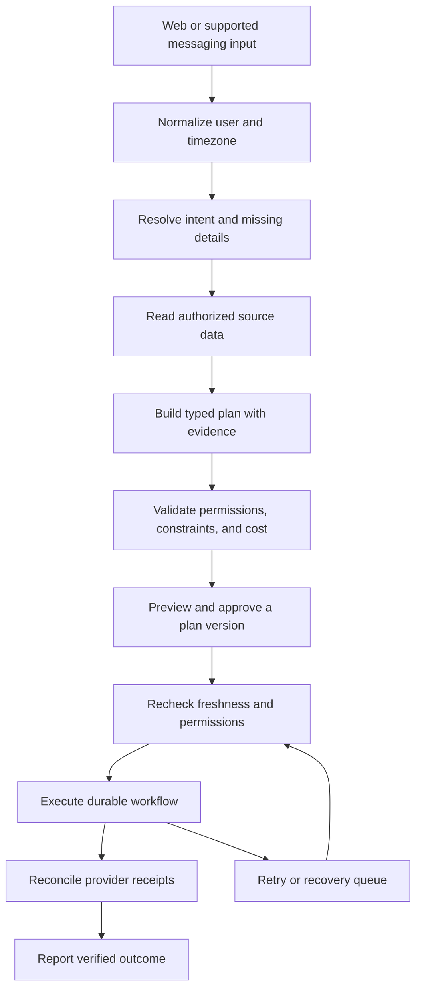

# Workflows, algorithms, and a practical build plan

## Language and stack choice

Use **TypeScript as the primary production language**, with React/Next.js for the web interface and Node.js for the API and connector workers. One language across UI, plans, API contracts, and adapters keeps an early team simpler. Use SQL/PostgreSQL for transactional task state, permissions, and audit records. HTML and CSS remain the interface foundation. Python is optional for offline evaluation, data processing, or model experiments; a Python service is not required to launch this app.

For a mobile app after the workflow is proven, React Native lets a TypeScript team reuse contracts and logic. Native Swift/Kotlin are reasonable later if platform-specific features require them. Do not split an initial product across several languages without a concrete need.

This repository deliberately starts with dependency-free JavaScript ES modules, Node's HTTP server and test runner, and plain HTML/CSS. It is runnable immediately, with no framework install, model bill, or credentials. It is not the final production architecture. Add TypeScript and React when the domain model and interaction flow have been validated; preserve these approval/retry tests during migration.

Suggested production components: PostgreSQL; a durable job system such as Temporal; OAuth provider SDKs; a structured-output-capable LLM behind a model adapter; centralized metrics and error reporting. Redis is optional for cache/rate limits, not the sole source of task truth. Choose one worker system rather than combining several competing queue frameworks in the first version.

## Overall workflow



The browser never receives OAuth refresh tokens. The LLM proposes a plan; a server-side policy layer determines which tools and actions are permitted. Retrieved email/web content is untrusted data and cannot grant permissions or change approval requirements.

## Three concrete workflows

### Schedule a meeting

Input: “Find 30 minutes with Sam next Tuesday afternoon.” Resolve which Sam, user timezone, the date, attendee addresses, and meeting duration. Ask when ambiguous. Query only authorized calendar data. Do not assume access to Sam's calendar: without sharing, use a scheduling link or offer proposed slots for confirmation.

Merge all accessible busy intervals, add buffers and working-hour constraints, and rank feasible slots. Show local time, timezone, attendees, duration, and why the proposed slot works. Bind approval to the exact event payload. Immediately before writing, fetch current free/busy data again. If a conflict appeared, return a revised plan for approval. Create the event with a stable action identity, then record and verify the provider event ID. A sent invitation is not proof that attendees accepted.

Current demo: the request selects the scheduling template; it uses a fixed October 13, 2026 calendar, 30-minute duration, ten-minute buffers, and the first available gap. It neither resolves Sam nor interprets next Tuesday.

### Send a follow-up

Input: “Follow up on the proposal I sent Sam.” Resolve the person and authorized email thread. Present the source message, exact recipient, subject, and draft. Require explicit approval of this message version. At execution, verify permission and thread state, send once, and record the provider message ID. Do not claim delivery/read status unless the provider supplies it. If the thread received a response since planning, stop and propose an updated draft.

Current demo: a fixed sample message is displayed. Approval and execution save a simulated result; no real recipient or account is involved.

### Prepare a daily brief

Retrieve authorized calendar/task data for the user's local day. Use deterministic counts and a small structured summary; every factual item links to its source. Omit unavailable data and label partial coverage. Persist the brief and show it locally. Distribution through a messaging channel is a separate approved action with channel-specific consent and delivery rules.

Current demo: the brief is a fixed sample, not a summary of live accounts.

## Algorithms

### 1. Intent resolution and typed plan validation

For a production planner, constrain model output with a JSON schema rather than accepting arbitrary tool commands:

```text
Plan {
  id, version, owner_id, intent,
  timezone, deadline, unresolved_fields[],
  evidence[{provider, record_id, observed_at}],
  actions[{id, tool, args, depends_on[], required_scopes[],
           external_write, reversible, estimated_cost}],
  expires_at
}
```

Use a small deterministic validator after the model: tool must exist; arguments must match its schema; dependencies must form an acyclic graph; required scopes must be granted; user-provided entities must resolve; costs must fit the budget. Any unresolved recipient or scheduling ambiguity blocks the corresponding write. Confidence scores from an LLM are not proof that a recipient/time is correct.

Prototype implementation: `lib/planner.mjs` matches three intent families using rules and returns a known plan. Multiple intent families and unsupported requests block, rather than silently execute a partial plan.

### 2. Scheduling by interval subtraction

Convert provider timestamps to UTC instants while retaining the user's IANA timezone for local workday construction and display. For `n` busy intervals, sort by start, extend each by the buffer, and sweep through them to merge overlaps. Subtract their union from allowed working windows. For multiple attendees, union their busy intervals first; availability is the complement inside the shared working window. Sorting costs `O(n log n)` and scanning costs `O(n)`.

```text
cursor = window.start
for [start, end] in sorted buffered busy blocks:
    if start > cursor: emit free gap [cursor, min(start, window.end)]
    cursor = max(cursor, end)
emit [cursor, window.end] if cursor < window.end
discard gaps shorter than requested duration
```

The demo emits one candidate at the beginning of each of the first three qualifying gaps. A production version can enumerate slots on a grid and rank them using explicit preferences:

`score = w1 × preferred_hours + w2 × earlier_completion − w3 × fragmentation − w4 × timezone_inconvenience`

Choose weights with users, not arbitrary opaque model judgment. Hard constraints are filters, never penalties that a high score can override. Test daylight-saving gaps/overlaps, all-day events, recurring events, private events, attendee availability, stale reads, and boundary buffers. The current scheduler tests cover interval merging, buffers, duration, invalid windows; they do not establish those additional provider/timezone capabilities.

### 3. Approval bound to a plan version

Generate a canonical digest over `owner_id`, plan version, actions, arguments, recipients, times, cost ceiling, and expiry. Store approval against that digest. A changed recipient, body, time, permission, or expired plan invalidates approval. Worker execution compares the digest and current authority before each external action. Source refresh can trigger replanning; do not quietly rewrite an approved payload.

In the demo, plans are immutable after creation and API state transitions enforce approval. Version-bound hashes and approval expiry are production work, not implemented features.

### 4. Durable execution and duplicate prevention

Represent multi-step plans as a directed acyclic graph; execute actions only after their prerequisites are verified. Save progress transactionally. Give each external action a stable key such as `SHA256(owner + plan_id + version + action_id)`; key versioning ensures an edited plan is a new action. Use provider idempotency features where available. Keep a unique database constraint and an outbox for work publication.

Retries use bounded exponential backoff with jitter: `delay = random(0, min(cap, base × 2^attempt))`; respect provider Retry-After. Retry transient errors; put permanent errors in a recovery queue. If a send timed out after provider acceptance, reconcile through provider records before retrying. If reconciliation cannot establish the result, mark it unknown and ask for intervention instead of risking another send. Exactly-once network delivery cannot be guaranteed merely by having a local idempotency key.

Prototype implementation: creation keys deduplicate identical requests; a serialized mutation queue protects local state; completed tasks return the existing result when run again. These guarantees apply only to the simulated single-process store. External reconciliation, multi-worker locking, and real network retries are future work.

### 5. Compensation and recovery

For reversible steps, register a compensation action: remove a draft event or restore a prior record version when supported. Execute compensations in reverse dependency order, with their own approval policy if they have external impact. Email delivery is generally not reversible; “undo” cannot be promised for it. Show partial success and separate the action result from the recovery result.

The current app demonstrates a narrower recovery: pause a demo connector, execute an approved task, see failure, restore the connector, then retry. It has no external side effects to compensate.

### 6. Explicit preference memory

Store only useful preferences that the user saves or confirms, e.g., preferred hours and meeting buffers. Each record has a value, scope, source, timestamp, expiry, and editable UI. Retrieval order should be explicit user instruction, confirmed preference, then conservative default. Conflicts require clarification. Vector search is optional for finding text evidence; SQL is preferable for permissions and scheduling rules. Never let an embedded web page override a user preference or approval policy.

## Production data model

Use tables for users, connector_accounts, granted_scopes, preferences, requests, plans, actions, approvals, execution_attempts, provider_receipts, audit_events, and outbox_jobs. Enforce owner scoping on every query; use row-level security as an additional guard. Approval records reference an immutable plan version. Action identity is unique within owner/plan/version. Provider receipts are retained with minimal metadata and documented retention.

Store refresh tokens encrypted through a managed key service; avoid tokens in logs, browser state, plans, prompts, or repository files. OAuth scopes should grow only when a user chooses a feature that needs them. Use provider-supported revocation. Logs should minimize email content and redact secrets. Production audit records require access controls and retention; the demo JSON history is not tamper-resistant.

## Build sequence

| Stage | Deliverable | Verification before moving on |
| --- | --- | --- |
| Current starter | Visual ring, request planner, approval queue, simulated execution, persistence | Existing HTTP tests and browser checks pass |
| Domain migration | TypeScript contracts, React UI, PostgreSQL state | Preserve API behavior and test migration/persistence |
| Accounts | App login and Google OAuth with read-only calendar scope | Account isolation, token expiry, disconnect, and permissions verified |
| Calendar workflow | Real free/busy reads, timezone resolution, approved event creation, provider receipts | Conflict/freshness tests and sandbox writes reconcile correctly |
| Email workflow | Authorized thread lookup, recipient resolution, draft preview, approved send | Changed drafts invalidate approval; timeout-after-send test does not duplicate |
| Durable engine | Durable jobs, retry/recovery queue, idempotency and reconciliation | Kill worker mid-action; resume safely and report unknown outcomes accurately |
| Planner and pilot | Structured LLM planning, explicit preferences, cost limits, evaluation set | Evaluate correctness against rule-based baseline and publish failure categories |
| More channels | Supported messaging providers and mobile UI | Verify provider constraints, consent, delivery semantics, and channel permissions |

For evaluation, keep a versioned fixture set of ordinary, ambiguous, timezone, expired-permission, stale-source, malicious-content, duplicate-webhook, and partial-failure cases. Track verified success, wrong external actions, unnecessary clarifications, recovery burden, latency, and cost per verified outcome. Run deterministic tests for policy and execution separately from model evaluation. Do not use a model's own judgment as the only correctness test.

## Environment and GitHub

The existing checkout is `/workspace/Automator`; cloud tasks already have an isolated workspace, so use it rather than creating a worktree. Startup requires Node 22+, `npm test`, then `npm start`. No dependencies need installation in this version. Retain `.local/state.json`, but restart the server in a new task; live processes are not part of a filesystem snapshot. Saved environment startup instructions register this procedure.

The prototype is bound to loopback and has no authentication. Do not expose it publicly as a production service. Creating a live multi-user deployment and connecting credentials are separate steps from publishing the development environment. No secret values belong in GitHub.
